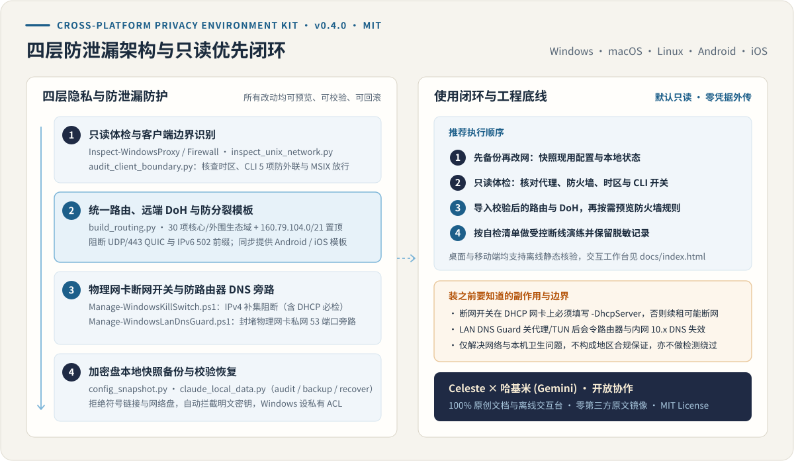

<p align="center">
  
</p>

<h1 align="center">跨平台网络隐私与本机环境工具包</h1>

<p align="center">
  <b>只读体检、统一路由、Windows 防泄漏护盾、配置安全快照、干净原创实测报告与离线交互工作台——按需取用，不做黑箱。</b>
</p>

<p align="center">
  <a href="#这是什么"><b>这是什么</b></a>
  &nbsp;·&nbsp;
  <a href="#交互式展示与配置工作台ui"><b>交互工作台</b></a>
  &nbsp;·&nbsp;
  <a href="#快速开始"><b>快速开始</b></a>
  &nbsp;·&nbsp;
  <a href="#干净版跨端实测综合报告"><b>综合报告</b></a>
  &nbsp;·&nbsp;
  <a href="#验证到哪一步"><b>验证边界</b></a>
  &nbsp;·&nbsp;
  <a href="#包内目录与模块"><b>包内目录</b></a>
  &nbsp;·&nbsp;
  <a href="#许可与署名"><b>许可与署名</b></a>
</p>

<p align="center">
  <a href="https://github.com/rumpelpalmour757-lgtm/cross-platform-privacy-environment-kit/stargazers"></a>
  <a href="CHANGELOG.md"></a>
  <a href="claude-doh-domains.txt"></a>
  <a href="#验证到哪一步"></a>
  
  <a href="LICENSE"></a>
  <a href="https://github.com/rumpelpalmour757-lgtm/cross-platform-privacy-environment-kit/actions/workflows/tests.yml"></a>
</p>

<p align="center">
  <a href="https://rumpelpalmour757-lgtm.github.io/cross-platform-privacy-environment-kit/"></a>
  <a href="https://github.com/rumpelpalmour757-lgtm/cross-platform-privacy-environment-kit/releases/tag/v0.4.2"></a>
  <a href="docs/CLIENT-BOUNDARY-AND-LEAK-REPORT.md"></a>
</p>



## 这是什么

这是一套面向 **Windows、macOS、Linux、Android、iPhone / iPad** 的开源网络隐私工程与本机环境自查工具包，主流程是：**只读体检摸清现状 → 生成并静态校验跨端路由 → 按需部署 Windows 防 DNS 旁路或严格断网开关 → 私有权限快照备份与还原**。所有脚本仅使用系统自带运行时与 Python 3.10+ 标准库，默认操作全部只读且自动脱敏本机路径，不内置客户端二进制，也不碰账号凭据。

- **先预览、后变更、随时可回退** — Windows 防火墙与断网脚本均强制区分 `Preview` / `Install` / `Status` / `Remove`；断网开关检测到 DHCP 网卡但漏填 `-DhcpServer` 时直接拒绝安装，避免续租被拦锁死网络。断网开关的回退办法是 `-Action Remove` 和文档里的手工撤销命令；LAN DNS Guard 安装前另外导出一份 `.wfw` 防火墙策略备份，并在日志里记录它的 SHA-256（只记录，不比对），备份位置和导回的后果见 [WINDOWS-KILL-SWITCH.md](WINDOWS-KILL-SWITCH.md)。
- **桌面与 Android 共用同一份生态清单、离线 UI 与 Python 对账** — Windows（v2rayN）的两份生态置顶预设与 Android（v2rayNG + 离线二维码）规则包的前 4 条：30 项生态条目、`160.79.104.0/21` 与两个 Anthropic IPv6 前缀逐项相同，也都置顶阻断 UDP/443；iOS（Shadowrocket）模板是另一种写法：本地地址直连、公网 IPv6 在隧道内拒绝、其余全部走代理，没有国内直连分流，也没有 UDP/443 阻断。macOS 与 Linux 不带路由规则。离线工作台生成的路由 JSON 在单测中与 `build_routing.py` 的输出逐项比对，断网规划器在单测中与 `build_kill_switch.py` 比对规则表。
- **干净原创、无第三方原文镜像** — `v0.4.0` 公开前已彻底移除此前私有备份里的第三方文章与微信转发镜像目录，并重建干净的 Git 提交历史；所有外部背景仅保留公开出处链接（见 [THIRD-PARTY-NOTICES.md](THIRD-PARTY-NOTICES.md)）。
- **明确的能力与合规边界** — 本项目聚焦网络隐私工程、DNS 洁净度、断线防静默回落与安全备份可靠性；仅靠网络配置不能替代服务商的使用条款或地区政策，本项目也不提供任何检测绕过或风控对抗方案。

## 交互式展示与配置工作台（UI）

可以直接访问在线演示 **[GitHub Pages 交互工作台](https://rumpelpalmour757-lgtm.github.io/cross-platform-privacy-environment-kit/)**，或者克隆/下载后在浏览器离线双击打开 [docs/index.html](docs/index.html)（**零外部 CDN、零追踪脚本、支持明暗双主题**）。

<table>
  <tr>
    <td width="112" align="center">
      
    </td>
    <td>
      <b>五大交互面板 + 哈基米（Gemini）协作小助手</b><br>
      1. <b>总览与架构</b>：五端入口矩阵、四层纵深防护说明，以及 <b>Celeste × 哈基米（Gemini）</b> 共创名片与互动避坑贴士。<br>
      2. <b>路由工作台</b>：与 <code>build_routing.py</code> 同源的 5 套预设（分流 + 生态置顶、全公网 + 生态置顶、标准国内直连分流、标准全公网代理、外网优先分流），实时预览、复制或下载路由 JSON 与 30 项加密 DNS 清单。<br>
      3. <b>Windows 防火墙规划器</b>：与 <code>build_kill_switch.py</code> 同源的规则表与 IPv4 补集区间计算、DHCP 漏填预警、断网开关与 LAN DNS 旁路防护命令生成（卸载命令单独一块）与副作用提示。<br>
      4. <b>跨端隐私自检清单</b>：参考 <code>PRIVACY-CHECKLIST.md</code> 整理（条目与文档不一一对应），可勾选并自动保存在本地浏览器 <code>localStorage</code>，支持一键导出 Markdown / JSON 验收记录。<br>
      5. <b>干净版报告浏览器</b>：可视化对照 CLI 冷启动归零实测、MSIX 防火墙规则的离线静态拆检、三态体检与工程权衡卡片、「网页登录卡在哪一步？」分步排查、五端边界矩阵与六大常见误区卡片；右下角随时可展开「哈基米贴士」。
    </td>
  </tr>
</table>

## 快速开始

### 按平台选择入口

| 平台 / 场景 | 推荐入口 |
| :--- | :--- |
| **在线 / 离线交互 UI** | 打开 [GitHub Pages 工作台](https://rumpelpalmour757-lgtm.github.io/cross-platform-privacy-environment-kit/) 或本地 [docs/index.html](docs/index.html) 生成配置与自检。 |
| **Windows** | 先看 [CLAUDE-PROXY-OPTIMIZATION-GUIDE.md](CLAUDE-PROXY-OPTIMIZATION-GUIDE.md) 与下方的只读体检、路由和防火墙命令；严格断网开关见 [WINDOWS-KILL-SWITCH.md](WINDOWS-KILL-SWITCH.md)。 |
| **macOS / Linux** | 运行 `python3 environment_report.py --html-out ./env-health.html` 导出三态脱敏体检报告（内置客户端边界与本地 MCP 盘点），并按 [PRIVACY-CHECKLIST.md](PRIVACY-CHECKLIST.md) 核查边界。 |
| **Android** | 见 [mobile/README.md](mobile/README.md)，通过 13 条规则 JSON 或配套离线二维码导入 `v2rayNG`，并核对电池保活与原生 App 边界。 |
| **iPhone / iPad** | 见 [mobile/README.md](mobile/README.md)，导入已开启 IPv6 隧道接管的 Shadowrocket 模板并验收。 |
| **深度实测与边界** | 阅读干净原创综合报告 [docs/CLIENT-BOUNDARY-AND-LEAK-REPORT.md](docs/CLIENT-BOUNDARY-AND-LEAK-REPORT.md)。 |

### Windows 常用命令（默认先只读）

#### 1. 只读体检与客户端边界核查

```powershell
py -3 .\environment_report.py --html-out .\env-health.html
powershell.exe -NoProfile -ExecutionPolicy Bypass -File .\Inspect-WindowsProxy.ps1
powershell.exe -NoProfile -ExecutionPolicy Bypass -File .\Inspect-WindowsFirewall.ps1
py -3 .\audit_client_boundary.py
```

`environment_report.py` 已内置合并 `audit_client_boundary.py`，输出三态安全摘要（**已通过 / 存在缺口 / 未知盲区 `unknown`**）与可离线双击浏览/打印存 PDF 的 HTML 体检单；自动遮盖个人用户名、自定义网卡名与本地 MCP 命令，并核查 CLI 5 项防后台外联开关与本地 MCP 桥接数量（加 `--project-dir <项目目录>` 时把该项目的 `.mcp.json` 也算进去；配置文件读不了时记为 `unknown`，不当作 0）。关于桌面端，统一体检只报告本机是否装了 Desktop；MSIX 自动写入的防火墙放行规则要看 `Inspect-WindowsFirewall.ps1` 输出的 `MsixClaudeOutboundAllowCount`。

> 体检单里没有用户名和路径，但带着宿主机的时区、UTC 偏移和区域语言，转发或公开前请留意。本仓库的 `.gitignore` 忽略根目录下的 `.html`、`env-health*.html`、`evidence/`、`*.wfw` 和 `*.jsonl`；把工具包放进你自己的 Git 仓库时，也请别把这些本机输出提交上去。

#### 2. 跨端路由规则生成与静态校验

```powershell
py -3 .\build_routing.py validate .\routing-template.json
py -3 .\build_routing.py validate .\routing-claude-ecosystem.json --claude-ecosystem
py -3 .\build_routing.py validate .\routing-claude-global.json --global-proxy --claude-ecosystem
py -3 .\build_routing.py print-doh-domains
```

- 启用严格断网开关或要求最高出口一致性时，建议使用 [routing-claude-global.json](routing-claude-global.json)，将 `domainStrategy` 设为 `AsIs` 并把 [claude-doh-domains.txt](claude-doh-domains.txt) 绑定到远端加密 DNS。其他域名策略没有测过：选了遇到 IP 规则就先解析域名的策略（如 `IPOnDemand`）时，解析到两个 Anthropic IPv6 前缀的主机名可能在 IPv6 阻断那一条就被拦下，表现为打不开。
- 保留国内直连分流时，建议使用 [routing-claude-ecosystem.json](routing-claude-ecosystem.json)（30 项生态条目、IPv4 网段与 IPv6/QUIC 兜底均排在 `geosite:cn` 之前）。
- 使用 [refresh_allowlists.py](refresh_allowlists.py) 拉取上游国内直连预览时，建议显式指定已审阅的 `--commit <40位SHA>` 及 `--expected-direct-sha256` / `--expected-cidr-sha256`。

#### 3. 物理网卡防路由器 DNS 旁路（保留分流时推荐）

```powershell
powershell.exe -NoProfile -ExecutionPolicy Bypass -File .\Manage-WindowsLanDnsGuard.ps1 -Action Preview -IncludeAllPhysicalAdapters
# 管理员 PowerShell 安装与核查（安装前导出 .wfw 防火墙备份，SHA-256 记进日志）：
powershell.exe -NoProfile -ExecutionPolicy Bypass -File .\Manage-WindowsLanDnsGuard.ps1 -Action Install -IncludeAllPhysicalAdapters
powershell.exe -NoProfile -ExecutionPolicy Bypass -File .\Manage-WindowsLanDnsGuard.ps1 -Action Status -IncludeAllPhysicalAdapters
```

卸载单独一条，不要和上面几条一起粘贴执行：

```powershell
powershell.exe -NoProfile -ExecutionPolicy Bypass -File .\Manage-WindowsLanDnsGuard.ps1 -Action Remove
```

> **明确副作用**：安装后只要关闭代理客户端或 TUN，系统 DNS 指向路由器（家用网络默认配置）的请求会全部解析失败，公司内网 `10.x` 等私网 DNS 也会被封。规则不分程序，代理客户端自己经路由器 DNS 解析节点域名时，开着代理也可能连不上。需要直连家用或内网 DNS 时，执行 `-Action Remove` 即可恢复；`.wfw` 备份放在哪里、怎样导回、脚本跑不起来时的手工撤销，详见 [WINDOWS-KILL-SWITCH.md](WINDOWS-KILL-SWITCH.md)。

#### 4. 严格断网开关与真实 TUN 连通校验

完整步骤见 [WINDOWS-KILL-SWITCH.md](WINDOWS-KILL-SWITCH.md)（使用 DHCP 网卡时**必须**传入 `-DhcpServer`，安装前先 `Preview`；那一节的命令要先在窗口里执行 `Set-ExecutionPolicy -Scope Process -ExecutionPolicy Bypass`；工具包请放在个人主目录下的子文件夹，这一版放在 `C:\Program Files` 下会被拒，见该文档的已知问题）。需要观察 TUN 开着时能不能连通时，用普通用户执行：

```powershell
powershell.exe -NoProfile -ExecutionPolicy Bypass -File .\Test-ProxyState.ps1 -Stage normal -AsJson
```

它只向一个网址发一次 HTTPS `HEAD` 请求，看连没连上，不报告出口 IP；默认探测地址是 `https://example.com/`，会真的向这个站点发请求，可以用 `-ProbeUrl` 换成自己的站点。未检测到活动 TUN 隧道路由时，`-Stage normal` 会默认拒绝发包，防止误用真实 IP 直连测试站点；TUN 只接管 IPv4 时请加 `-AddressFamily ipv4`。`tun-down`、`client-down` 等断线阶段怎么做、结果怎么读，见 [WINDOWS-KILL-SWITCH.md](WINDOWS-KILL-SWITCH.md) 的「断线演练」一节。

#### 5. 配置目录与 Claude 本地数据私有快照

两个脚本分工不同：`config_snapshot.py` 备份 v2rayN 的配置目录，**不做明文密钥检查**，快照就是明文，里面有订阅地址和口令；明文密钥检查只有 `claude_local_data.py` 有。两者都只写本机磁盘、拒绝符号链接，Windows 上给快照设当前账户私有的 NTFS 权限。存放快照的目录要事先建好，只有你自己能访问，最好放在已启用磁盘加密的本机盘上（脚本不检查磁盘是否加密）。

```powershell
# 代理客户端配置快照：不加 --backup-root 时放在 ~/clash-guard-backup（即 %USERPROFILE%\clash-guard-backup）
py -3 .\config_snapshot.py backup --config-dir "C:\实际路径\guiConfigs" --backup-root "<只有自己能访问的本机目录>"
py -3 .\config_snapshot.py verify "<生成的快照目录>"
# 恢复到一个新目录（不动原配置）：
py -3 .\config_snapshot.py recover "<快照目录>" --destination "<已存在的本机目录>"
# 原位还原：默认只预览、不改文件；加 --apply --client-stopped 才替换，且只支持 Windows
py -3 .\config_snapshot.py restore "<快照目录>" --config-dir "C:\实际路径\guiConfigs"
py -3 .\config_snapshot.py restore "<快照目录>" --config-dir "C:\实际路径\guiConfigs" --apply --client-stopped
```

- `restore --apply` 先确认 v2rayN 和代理核心都已退出，替换下来的旧配置留在命令打印的 `Prior config retained at:` 路径里。其他平台用 `recover` 恢复到新目录，在客户端关闭时自己替换数据目录。

```powershell
# Claude Code 本地数据：盘点、备份、校验、恢复到新目录
py -3 .\claude_local_data.py audit
py -3 .\claude_local_data.py backup --destination "C:\Users\<USER>\claude-backups"
py -3 .\claude_local_data.py verify "<生成的快照目录>"
py -3 .\claude_local_data.py recover "<快照目录>" --destination "<已存在的本机目录>"
```

- `--destination` 指向的目录要事先建好，而且只有你自己能访问；不存在时报 `The destination directory does not exist.`。`recover` 恢复到一个新目录，可以直接选放快照的那个目录，但不能选快照里面。
- 备份前对 `settings.json`、`settings.local.json`、`.mcp.json` 做启发式的明文密钥检查（键名、常见密钥形状、URL 里的口令、命令行参数里的密钥）；这些文件不是严格 JSON（带注释、尾逗号）时按“无法确认”拒绝。藏在 URL 路径里的令牌、写成 JSON 数字的值、`-p` 这类短参数后面的值查不出来；权限规则里的命令名（如 `Bash(gh auth token:*)`）、`--key` 后面的文件路径、命令里的 `$变量` 不算明文密钥。会话记录（`history.jsonl`、`projects/`）不检查。加 `--allow-inline-secrets` 会照样备份，并列出放过了哪些文件和键名。
- 按文件名排除的东西不进备份：`.env*`、`*.key`、`*.pem` 这类密钥文件、`auth.json`、`token.json`、`credentials.json` 等凭据文件和 `.git`。排除了几个，备份完成时会打印一行，并记进快照的 `manifest.json`。
- “只允许本机盘”实际查了什么：Linux 按 `/proc/mounts` 拒绝 NFS、SMB、9p、sshfs 等网络或共享文件系统；macOS 只拦 iCloud（`~/Library/Mobile Documents`）和 `~/Library/CloudStorage` 下的目录，不查 `/Volumes` 下的网络卷；Windows 只看盘符类型（拒绝网络驱动器），不查 OneDrive 等同步目录。`claude_local_data.py audit` 只读元数据，在网络盘或同步目录上照常盘点，结果里注明 `network_or_synced_storage`；`backup` 仍然拒绝。

## 干净版跨端实测综合报告

完整原创报告见 **[docs/CLIENT-BOUNDARY-AND-LEAK-REPORT.md](docs/CLIENT-BOUNDARY-AND-LEAK-REPORT.md)**，与操作清单 [CLAUDE-PROXY-OPTIMIZATION-GUIDE.md](CLAUDE-PROXY-OPTIMIZATION-GUIDE.md)、[PRIVACY-CHECKLIST.md](PRIVACY-CHECKLIST.md) 互相对应。报告采用干净原创结构，覆盖六大核心内容：

1. **研究方法与能力边界**：严格区分「本机独立实测验证」与「社区公开研究背景」，拒绝夸大网络工具的边界。
2. **五端客户端网络边界矩阵**：逐端梳理独立隔离浏览器、官方 CLI、官方 Windows MSIX Desktop、独立科研桌面端与 Android 原生 App 能管什么、管不了什么。
3. **四层无侵入本机实测（已彻底脱敏）**：包括 CLI `2.1.330` 未登录冷启动从 **3 次外联 + 549 KB（241 条事件）** 降为 **0** 的对照验证；Desktop `6.28899.6` MSIX 安装包的离线静态拆检（清单里声明了两条出站 `Allow` 规则，与断网兜底的冲突是按清单和防火墙求值规则推断的，没有在已安装的环境里观测）；以及 39 个目标的分流与 DoH 对账（这 39 个目标的逐条清单没有随仓库发布，仓库里能复核的是现行 30 项生态条目和几个网段）。
4. **工程盲区与 Cage 个案**。报告第 4 节区分了出口信誉、本地 MCP 桥接和桌面渲染的观察范围。第 4.2 节核对了两次客机网关事件，并按验证框加载失败、手动完成后循环、返回站点后出现限制提示三个阶段给出记录方法。
5. **工具包落地映射与操作副作用**：把每条实证直接落到本仓库的对应脚本与参数，并如实写明每一项副作用。
6. **干净的外部参考索引**：不夹带任何第三方原文，主要背景来源的公开链接收录在 [THIRD-PARTY-NOTICES.md](THIRD-PARTY-NOTICES.md)；正文里另有少量就地引用的官方文档链接。

## 包内目录与模块

| 路径 / 文件 | 说明 |
| :--- | :--- |
| [docs/index.html](docs/index.html) · `docs/styles.css` · `docs/app.js` | 零外部依赖的离线交互式展示与配置工作台 UI（GitHub Pages 入口） |
| [docs/CLIENT-BOUNDARY-AND-LEAK-REPORT.md](docs/CLIENT-BOUNDARY-AND-LEAK-REPORT.md) | 干净原创的跨端客户端边界、四层本机实测与网络防泄漏综合报告 |
| [docs/images/](docs/images/architecture-cover.svg) | 项目徽标 `logo.svg`、架构总览图 `architecture-cover.svg` 与哈基米徽章 `hajimi-mascot.svg` |
| [CLAUDE-PROXY-OPTIMIZATION-GUIDE.md](CLAUDE-PROXY-OPTIMIZATION-GUIDE.md) · [PRIVACY-CHECKLIST.md](PRIVACY-CHECKLIST.md) | 代理与分流落地优化指南、全平台日常/排错核对清单 |
| [build_routing.py](build_routing.py) · [claude-doh-domains.txt](claude-doh-domains.txt) · `routing-*.json` | 30 项生态条目置顶的路由生成器、DoH 域名清单与 3 套开箱即用路由模板 |
| [Manage-WindowsLanDnsGuard.ps1](Manage-WindowsLanDnsGuard.ps1) · [build_lan_dns_guard.py](build_lan_dns_guard.py) | Windows 物理网卡防路由器 53 端口旁路脚本（安装前导出 `.wfw` 备份并记录 SHA-256）与对照规划器 |
| [Manage-WindowsKillSwitch.ps1](Manage-WindowsKillSwitch.ps1) · [build_kill_switch.py](build_kill_switch.py) · [WINDOWS-KILL-SWITCH.md](WINDOWS-KILL-SWITCH.md) | Windows 严格断网开关（含 DHCP 防误锁；回退靠 `-Action Remove` 与手工撤销命令，不导出 `.wfw`）及说明、已知问题 |
| [Inspect-WindowsProxy.ps1](Inspect-WindowsProxy.ps1) · [Inspect-WindowsFirewall.ps1](Inspect-WindowsFirewall.ps1) · [Test-ProxyState.ps1](Test-ProxyState.ps1) | Windows 只读代理/防火墙体检、MSIX 放行规则计数，以及按阶段观察 TUN 与断线时的连通性 |
| [Collect-WindowsEvidence.ps1](Collect-WindowsEvidence.ps1) · [Get-WindowsKillSwitchEvidence.ps1](Get-WindowsKillSwitchEvidence.ps1) | 统一体检在 Windows 上调用的只读采集器（汇总路由、DNS 与防火墙现状）；把一次受控探测与安全日志 5157 阻断事件关联起来的验收脚本 |
| [environment_report.py](environment_report.py) · [audit_client_boundary.py](audit_client_boundary.py) · [inspect_unix_network.py](inspect_unix_network.py) | 统一三态环境体检与离线可打印 HTML 体检单导出、本地 MCP 桥接盘点与跨平台只读网络审计 |
| [config_snapshot.py](config_snapshot.py) · [claude_local_data.py](claude_local_data.py) · [refresh_allowlists.py](refresh_allowlists.py) | 私有权限配置快照备份/还原（两者都拒绝符号链接；明文密钥检查只有 `claude_local_data.py` 有）与上游直连名单预览 |
| [mobile/README.md](mobile/README.md) · `mobile/` | Android `v2rayNG` 13 条规则、离线二维码、静态校验器与 iOS Shadowrocket 模板 |
| [CHANGELOG.md](CHANGELOG.md) · [LICENSE](LICENSE) · [THIRD-PARTY-NOTICES.md](THIRD-PARTY-NOTICES.md) · [AUTO-UPDATE.md](AUTO-UPDATE.md) | 版本记录、MIT 许可、第三方参考声明与作者本机自动同步脚本的说明（默认不推送；脚本在 `tools/`，发布包里没有） |

## 验证到哪一步

只写跑过的，没跑过的不写成通过：

### 做过的

- **跨平台离线单元测试**：全套 `test_*.py`（项数以运行结果为准），覆盖统一三态体检与可打印 HTML 渲染/转义、本地 MCP 桥接脱敏盘点、路由生成与校验、Windows 断网开关与 LAN DNS 规划器、配置快照安全边界、Android/iOS 规则静态校验、自动同步脚本在临时仓库里的同步、还原与隐私闸门、MIT 与零镜像回归检查、全仓 Markdown 相对链接与发布包断链检查，以及通过 Node.js 对 `docs/app.js` 与 Python `build_routing.py` / `build_kill_switch.py` 的一致性交叉对账（平台专属用例按运行环境显式跳过）。v0.4.1 在 Windows Python 3.13 与 Linux（WSL Ubuntu）Python 3 下跑过；v0.4.2 的改动只在 Linux 上用 Python 3.11、3.12、3.13 跑过全套，还没有在 Windows 上跑过。
- **PowerShell 语法与逻辑核验**：所有 `.ps1` 脚本经解析与逻辑核查，确认 DHCP 漏填拦截与 PowerShell 5.1 严格模式空数组分支已修复；断网开关补集输出与 Python 规划器一致。v0.4.2 没有改 `.ps1`，已确认还没修的问题见 [WINDOWS-KILL-SWITCH.md](WINDOWS-KILL-SWITCH.md) 末尾的「已知问题」。
- **本机四层无侵入实测与可视化核验**：在隔离临时目录下完成 CLI `2.1.330` 冷启动归零对照、MSIX 安装包离线静态拆检与 39 目标路由分流对账；v0.4.1 时用无头浏览器实拍核验了 `docs/index.html` 明暗主题与矢量图的渲染排版，v0.4.2 改过的页面和架构图没有在浏览器里重新看过。
- **公开前隐私与历史核查**：公开前重建单提交干净历史，确认仓库工作区与 Git 历史中均无本机用户名路径、个人代理节点链接、第三方原文镜像或微信转发原文。

### 没做的

- **未在 CI 中修改真实防火墙或连真实代理节点**：单元测试验证规则规划与参数拦截，不会在 CI runner 上真实改写 Windows 防火墙或联网拨号；PowerShell 一侧只做语法解析和 `Preview` 对账，`Install`、`Remove`、`Status` 与防火墙回退都没有自动化测试。真实断网与断线演练需在个人主机按 [WINDOWS-KILL-SWITCH.md](WINDOWS-KILL-SWITCH.md) 受控执行。
- **包内不含 Xray 二进制**：`mobile/` 的校验器只做静态结构检查，不做真实内核路由回放；Android 校验器不逐条比对 13 条规则，也不要求兜底规则，改过的文件也可能通过（具体查哪几项见 [mobile/README.md](mobile/README.md)）。
- **未在 macOS 真机与旧版 PowerShell 5.1 实跑全部脚本**：macOS 侧逻辑按 Unix 网络接口单测与静态审查验证；PowerShell 5.1 兼容性通过静态语法与空集合边界修复保障，未在独立 Win10 5.1 环境全量实机安装断网开关。
- **不承诺账号结果或规避平台政策**：网络层与本机边界工具无法替代服务商的使用条款或地区政策。

## 离线自检命令

在仓库根目录执行以下命令即可离线复核全部测试（包含 UI 算法与文档链接回归检查）。只能在 Windows 上跑的用例，在 Linux 和 macOS 上会显示为跳过；发布包里没有 `tools/`、`docs/releases/` 和 `.gitattributes`，自动同步相关的用例和几项只在完整仓库里才有意义的检查在包里也会跳过，这都不算失败：

```bash
python -B -m unittest discover -p "test_*.py" -v
```

如果你要复用本仓库的本地自动同步与干净打包脚本，请参阅 [AUTO-UPDATE.md](AUTO-UPDATE.md)：默认只在本机提交、不推送（要推送必须加 `--push`），工作区不干净时拒绝运行，源目录里的新文件要用 `--allow-new` 点名，仓库里人工改过的文件不会被源目录悄悄覆盖；提交前照旧执行隐私与版权闸门（只是辅助检查）。脚本在 `tools/` 下，发布包里没有。

## 许可与署名

- **许可协议**：本仓库按 **MIT License** 开源发布，版权人 **Celeste**，全文见 [LICENSE](LICENSE)。外部背景链接与许可边界见 [THIRD-PARTY-NOTICES.md](THIRD-PARTY-NOTICES.md)。
- **作者与协作**：
  - 作者：**Celeste**（GitHub：[rumpelpalmour757-lgtm](https://github.com/rumpelpalmour757-lgtm)）
  - 协作开发与公开版重构：**哈基米（Gemini）** 与 AI 助手参与完成了 `v0.4.0–v0.4.1` 的 MIT 公开化整理、干净版原创综合报告归纳、三态可打印 HTML 体检单、零依赖离线交互工作台 UI（[docs/index.html](docs/index.html)）与配套矢量视觉资产；项目定位、隐私边界与公开发布均由作者审核拍板。
- **同系列公开项目**：[novel-workshop（小说写作工坊）](https://github.com/rumpelpalmour757-lgtm/novel-workshop) · [bjm-portable（BJM 通用迁移包）](https://github.com/rumpelpalmour757-lgtm/bjm-portable) · [rule-conflict-constitution（AI 协作宪法）](https://github.com/rumpelpalmour757-lgtm/rule-conflict-constitution)
